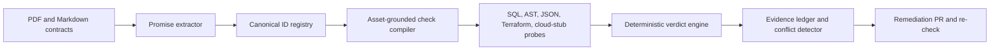

# Promise Ledger

Promise Ledger is an evidence-backed contract verification agent built by team **el el ems** for neatHack 2026. It reads real PDF and Markdown agreements, turns their promises into typed obligations, grounds each obligation to a fixed library of safe probes, and keeps the clause, system evidence, recovery path, and verdict in one reviewable ledger.

The demo audits [Tasklane](https://github.com/khushalkumar/tasklane-demo), a fictional multi-tenant SaaS with deliberately planted compliance defects.

## The demo result

One live audit extracts nine promises from three documents and produces:

- `P-014 violated` - the tenant purge omits `audit_events`, expired rows remain, and backup expiry is 90 days instead of 30.
- `P-017 holds` - the cloud snapshot API returns `AccessDenied`; the fixed Terraform fallback proves 30-day retention.
- `P-021 violated` - the exports provider is in `us-east-1`, outside the promised `eu-west-1` residency boundary.
- `P-031 unverifiable` - no authoritative subprocessor evidence source exists.
- Four MSA promises hold - Business-plan SSO, 99.9% availability credits, encryption at rest, and administrator MFA.
- `C-003 violated` - the 30-day DPA and 90-day public retention policy conflict.

Two open remediation PRs independently fix the `P-014` root causes. Applying both in an isolated checkout turns `P-014` green without hiding the remaining conditions:

- [Tasklane PR #1 - purge audit events](https://github.com/khushalkumar/tasklane-demo/pull/1)
- [Tasklane PR #2 - cap backup retention](https://github.com/khushalkumar/tasklane-demo/pull/2)

## How it works



The model reasons only where interpretation is required. Inventory, probe execution, evidence hashing, fallback selection, conflict checks, and verdicts are deterministic. The compiler selects from fixed probe templates; it never generates executable probe code.

Every agent and probe is instrumented with Neatlogs. A permission failure is a first-class trace event, not a false violation: `AccessDenied -> error -> Terraform fallback -> holds`.

## Run it

Promise Ledger targets Python 3.12 and uses `uv`.

```bash
uv sync --all-groups
cp .env.example .env
```

Supply the environment variables through your shell or secret manager. Never commit `.env`.

Seed the fictional target:

```bash
uv run --project ../tasklane-demo tasklane-seed ../tasklane-demo/artifacts/tasklane.db
```

Run the full model-to-verdict audit:

```bash
uv run ledger audit \
  --target ../tasklane-demo \
  --database ../tasklane-demo/artifacts/tasklane.db \
  --document contracts/Northwind_DPA_v3.pdf \
  --document contracts/Acme_MSA_2026.pdf \
  --document contracts/privacy_policy.md \
  --registry contracts/id_registry.json \
  --output evidence/run_live_audit.json
```

Repeat only the deterministic verification stage:

```bash
uv run ledger run \
  --target ../tasklane-demo \
  --database ../tasklane-demo/artifacts/tasklane.db \
  --promises contracts/promises.json \
  --output evidence/run_nine_baseline.json
```

Open the evidence interface:

```bash
PROMISE_LEDGER_RUN=evidence/run_live_audit.json uv run ledger-ui
```

Then visit `http://127.0.0.1:8000`.

## Production on GCP

The production path uses Cloud Run services, an autonomous Cloud Run Job, Cloud SQL PostgreSQL 16,
Secret Manager, Artifact Registry, Cloud Build, Cloud Scheduler, durable ledger state, and a $250
billing budget. Deployment is one scripted command after the GCP owner links billing and grants
the required roles; see [the GCP deployment guide](docs/gcp-deployment.md).

## Evidence

- `evidence/run_live_audit.json` - saved live Azure extraction plus deterministic verdicts.
- `evidence/run_entire_graph.json` - traced deterministic run with ranked Entire Graph inventory hits.
- `evidence/run_nine_baseline.json` - repeatable model-free baseline.
- `evidence/extraction_drift_split.json` - a recorded model-drift case handled by deterministic deduplication.
- `evidence/benchmark.json` - deterministic v1 vs. v2 compiler comparison over ten seeded cases.
- `evidence/neatlogs.md` - trace IDs, runtime coverage, benchmark evidence, and verification boundary.
- `evidence/entire.md` - runtime Entire Graph evidence plus the explicit checkpoint-capture boundary.
- `evidence/run_final.md` - compact judge-facing audit, remediation, improvement, and economics index.
- `evidence/run_remediated.json` - combined re-check of the two open remediation PRs.
- `evidence/remediation.md` - exact PR, commit, and verification chain.
- `evidence/cfo.md` - verified cfo.ai scenario model, export, and formula-check record.
- `evidence/cfo_scenario_model.xlsx` - cfo.ai spreadsheet export for Downside, Base, and Growth.
- `docs/business_plan.pdf` - measured unit economics, three operating scenarios, and the cfo.ai entry model.

The contracts and Tasklane data are entirely fictional. The generated PDFs are visibly marked as demonstration documents.

## Verification

```bash
uv run pytest -q
uv run ruff check .
uv build
```

## Team

**el el ems**
