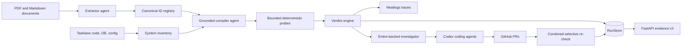

# Promise Ledger implementation guide

## 1. Mental model

Promise Ledger turns contract text into typed `Promise` records, maps them to safe probe templates, executes read-only checks against Tasklane, and calculates deterministic verdicts. `ledger agent-run` extends that audit into an autonomous recovery loop: investigate grounded failures, create one isolated coding-agent change per root cause, open real GitHub pull requests, combine their commits in a clean worktree, and re-run only affected probes.

The model interprets documents, selects validated checks, explains root causes, and writes narrow fixes. Inventory, probe execution, retry/fallback behavior, verdicts, state transitions, Git isolation, and selective re-checking are deterministic.

## 2. Architecture



Production runs the Tasklane API and evidence UI as Cloud Run services, the autonomous loop as a Cloud Run Job, and state/data in Cloud SQL PostgreSQL. Secret Manager supplies credentials; Cloud Scheduler starts the job.

## 3. Entry points

| Entry point | File and symbol | Purpose |
| --- | --- | --- |
| Full autonomous run | `ledger/cli.py` — `agent_run_command()` | Extract, audit, investigate, open real PRs, re-check, and persist the result. A supplied `--run-id` resumes from a saved baseline. |
| Audit only | `ledger/cli.py` — `audit_command()` | Extract, compile, execute, and save a `LedgerRun`. |
| Deterministic verification | `ledger/cli.py` — `run_command()` | Execute already-extracted promises without extraction calls. |
| Live compiler benchmark | `ledger/cli.py` — `bench_command()` | Run independent LLM v1 and grounded v2 paths and measure quality, tokens, latency, and estimated cost. |
| Evidence service | `ledger/web.py` — `main()` / `create_app()` | Render the latest durable final run or a configured JSON artifact. |
| Cloud autonomous job | `scripts/cloud-agent-run.sh` | Clone Tasklane, seed PostgreSQL, and invoke `ledger agent-run`. |
| GCP deployment | `scripts/deploy-gcp.sh` | Build, deploy, configure services/job/scheduler, and start the first job. |

## 4. End-to-end flows

### Flow: autonomous contract-to-PR run

**Trigger:** `ledger agent-run` locally or the `promise-ledger-agent` Cloud Run Job.

**Entry point:** `ledger/cli.py` — `agent_run_command()`

#### Step 1 — resolve or resume durable state

`agent_run_command()` opens `RunStore`, creates a stable run ID when one is not supplied, validates that an existing ID belongs to the requested repository, and loads the saved baseline when present. A resumed run skips extraction and baseline audit. `RunStore` supports SQLite and PostgreSQL via SQLModel.

#### Step 2 — extract and identify promises

`ledger/documents.py` — `load_document()` reads PDF or Markdown. `ledger/agents/extractor.py` — `extract_promises()` calls `AzureJsonBackend.complete_json()` and validates structured output. `ledger/registry.py` — `assign_canonical_ids()` maps clauses to stable IDs such as `P-014`.

#### Step 3 — inventory, compile, and execute

`ledger/orchestrator.py` — `run_ledger()` opens the Neatlogs workflow root. `ledger/inventory.py` — `build_inventory()` inspects database tables, Python sources, Terraform, JSON configuration, and optional Entire Graph hits. `ledger/agents/compiler_agent.py` — `compile_checks_with_agent()` asks the model to select every deterministic candidate from `compile_checks()`; it repairs one incomplete selection and rejects a second.

`ledger/probes/runner.py` — `run_probe()` gives every attempt a 30-second timeout and retries once. An exhausted `error` activates only the declared fallback; a `fail` never does. `ledger/probes/executors.py` — `execute_probe()` performs SQL, AST, Terraform, JSON, or cloud-stub checks. Its SHA-256 material includes the probe definition, result, and source/config bytes when applicable.

`ledger/verdict.py` — `evaluate_verdict()` calculates the result from effective probe outcomes. `ledger/conflicts.py` — `detect_conflicts()` adds cross-document contradictions.

#### Step 4 — investigate safe violations

`ledger/workflow.py` — `AutonomousWorkflow.remediate()` auto-remediates only `PromiseKind.DELETION_DEADLINE`. It stores the baseline and probe dependency index, then passes violated reports to `EvidenceInvestigator`.

`ledger/agents/investigator.py` — `EvidenceInvestigator.investigate()` runs `entire graph search`, `entire graph impact`, and `git log -L`. The LLM returns typed `RootCause` records. Paths and probe IDs are validated and multiple explanations for the same file are merged into one stable cause.

#### Step 5 — create real changes and PRs

`ledger/agents/remediator.py` — `RemediationAgent.remediate()` derives a stable branch per root cause and first asks `GhPullRequests.find_open()` for an existing PR. This makes resumed runs idempotent at the external-write boundary.

If none exists, `GitWorkspace.prepare()` creates an isolated worktree. `CodexCodingAgent.implement()` runs headless Codex with a strict output schema and a 15-minute timeout. `GitWorkspace.commit_and_push()` rejects secret-like files and commits as `Khushal Kumar <kkhushal1531@gmail.com>`. `GhPullRequests.ensure_open()` opens a normal, non-draft PR.

#### Step 6 — verify the combined effect

`ConfiguredRechecker.recheck()` creates a clean detached worktree from `origin/main`, cherry-picks every remediation commit, loads `.promise-ledger.json`, runs the target tests, seeds an isolated database, applies declared effect commands, and invokes `recheck_ledger()` only for probes affected by changed dependencies. It always removes the temporary worktree.

#### Final outcome

`AutonomousWorkflow` stores the final `LedgerRun`, records `completed`, and returns `AutonomousRunResult` containing baseline evidence, root causes, PR references, and rechecked verdicts. On failure it records the exception and `failed` stage before re-raising.

### Flow: evidence UI

`ledger/web.py` — `main()` uses `PROMISE_LEDGER_STATE_DATABASE` when present; otherwise it reads `PROMISE_LEDGER_RUN`. `GET /` selects each probe's effective primary/fallback result and renders `ledger/templates/ledger.html`. Valid trace IDs become safe `https://app.neatlogs.com/traces/{trace_id}` links. `GET /api/runs/latest` returns the same durable result as JSON.

### Flow: live v1/v2 benchmark

`ledger/benchmark.py` — `compare_compilers()` asks v1 to independently generate a probe plan from the promise, inventory, and supported template signatures. It validates and canonicalizes that plan before execution. V2 independently selects deterministic asset-grounded candidates. Both plans use the same probe runner and verdict engine; saved verdicts are used only as expected labels, never as predictions. The result records mismatch categories, model calls, token usage, wall-clock latency, estimated cost, and the active Neatlogs trace ID.

## 5. Data flow

```text
Document bytes -> Promise -> canonical ID -> AssetMap -> Probe -> ProbeExecution
-> ProbeResult (hash + trace) -> PromiseReport -> LedgerRun
-> RootCause -> AgentChange -> PullRequestRef -> selective LedgerRun
-> RunStore / JSON -> HTML and API
```

The target database URL is used only by SQLAlchemy. Evidence material never includes database credentials. GitHub, model, and tracing secrets remain environment/Secret Manager values.

## 6. Files and responsibilities

| File | Important symbol | Responsibility | Called by | Calls / depends on |
| --- | --- | --- | --- | --- |
| `ledger/cli.py` | `agent_run_command()` | User-facing orchestration and resume | CLI / cloud job | extraction, compiler, workflow, store |
| `ledger/workflow.py` | `AutonomousWorkflow` | Durable remediation state machine | CLI | investigator, remediator, rechecker |
| `ledger/store.py` | `RunStore` | Runs, stages, dependency index, baseline/final ledgers | workflow, UI | SQLModel / SQLite / PostgreSQL |
| `ledger/orchestrator.py` | `run_ledger()`, `recheck_ledger()` | Audit and selective verification | CLI, rechecker | inventory, compiler, runner, verdict |
| `ledger/agents/compiler_agent.py` | `compile_checks_with_agent()` | Validated model selection of safe candidates | orchestrator callers | fixed compiler, JSON backend |
| `ledger/probes/runner.py` | `run_probe()` | Timeout, retry, error/fallback, hashing handoff | orchestrator | executor, tracing |
| `ledger/probes/executors.py` | `execute_probe()` | Read-only SQL/AST/HCL/JSON checks | runner | SQLAlchemy, `python-hcl2` |
| `ledger/agents/investigator.py` | `EvidenceInvestigator` | Grounded root-cause evidence | workflow | Entire, git, model |
| `ledger/agents/remediator.py` | `RemediationAgent` | Stable branch and idempotent PR flow | workflow | coding agent, worktree, GitHub |
| `ledger/integrations/recheck.py` | `ConfiguredRechecker` | Combined clean-worktree verification | workflow | target config, git, orchestrator |
| `ledger/benchmark.py` | `compare_compilers()` | Independent measured comparison | CLI | two JSON backends, orchestrator |
| `ledger/web.py` | `create_app()` | Durable/read-only web and JSON API | `ledger-ui` | store, Jinja |
| `infra/gcp/main.tf` | Terraform resources | GCP runtime, data, IAM, budget | deployment owner | Google APIs |

## 7. Call graphs

```text
agent_run_command
  -> RunStore.ledger_result
  -> _extract_documents -> extract_promises
  -> run_ledger -> build_inventory -> compile_checks_with_agent -> run_probe
  -> AutonomousWorkflow.remediate
       -> EvidenceInvestigator.investigate
       -> RemediationAgent.remediate
            -> GitWorkspace.prepare
            -> CodexCodingAgent.implement
            -> GitWorkspace.commit_and_push
            -> GhPullRequests.ensure_open
       -> ConfiguredRechecker.recheck -> recheck_ledger
  -> RunStore.save_ledger_result
```

## 8. State, persistence, and side effects

- `RunStore` owns durable run rows, append-only stage events, probe dependencies, and baseline/final ledger payloads.
- Model calls occur during extraction, grounded compilation, investigation, and benchmark execution.
- Probes are read-only. The remediation path creates worktrees, commits, branches, pushes, and GitHub PRs.
- `RemediationAgent` checks for a stable open branch before writing, preventing duplicate PRs on resume.
- Neatlogs receives spans only when `NEATLOGS_API_KEY` initializes the SDK.
- The UI reads state and does not mutate the ledger.

## 9. External systems and integrations

| Boundary | Sent | Received | Failure behavior |
| --- | --- | --- | --- |
| Azure-compatible JSON LLM | prompts and schemas | validated JSON | validation/SDK errors fail the stage; compiler gets one repair attempt |
| Neatlogs | workflow, agent, tool, guardrail spans | trace IDs | disabled when no key; audit still runs |
| Entire CLI | repository query/symbol | ranked graph JSON | inventory degrades to filesystem; investigation requires evidence and fails closed |
| Codex CLI | narrow fix prompt + schema | changed files, tests, session ID | nonzero exit/timeout fails remediation |
| Git/GitHub CLI | branches, commits, PR metadata | SHA and PR reference | subprocess error fails and is persisted |
| SQL database | read-only compliance queries | counts/schema | runner retries, then records `error` and eligible fallback |
| GCP | images, services, job, secrets, schedule | deployed endpoints/executions | deploy script exits on first failed command |

## 10. Validation, errors, and edge cases

- Pydantic validates every agent output and domain record.
- Probe file paths cannot escape the target repository; SQL table identifiers use a strict identifier regex.
- Probe calls time out after 30 seconds and receive two attempts. Only exhausted errors activate fallback evidence.
- Missing grounded checks produce `unverifiable`, never `holds`.
- Auto-remediation is restricted to deletion deadlines; residency migrations and missing authority remain human decisions.
- Root causes must reference failed probe IDs and grounded repository files.
- Coding-agent output forbids extra fields and unsafe changed paths; commit logic blocks common secret-file extensions.
- A resumed run ID cannot be reused for another repository.

## 11. Configuration and environment

| Setting | Purpose |
| --- | --- |
| `PROMISE_LEDGER_AZURE_ENDPOINT`, `PROMISE_LEDGER_AZURE_API_KEY`, `PROMISE_LEDGER_AZURE_DEPLOYMENT`, `PROMISE_LEDGER_AZURE_API_VERSION` | JSON model backend |
| `NEATLOGS_API_KEY` | Runtime tracing |
| `OPENAI_API_KEY`, `CODEX_BINARY` | Direct OpenAI fallback authentication and coding-agent executable |
| `PROMISE_LEDGER_STATE_DATABASE` | Durable SQLite/PostgreSQL state and UI source |
| `PROMISE_LEDGER_RUN` | JSON UI source when no durable DB is configured |
| `NEATLOGS_TRACE_URL_TEMPLATE` | UI trace-link pattern; must contain `{trace_id}` |
| `TARGET_DATABASE_URL`, `TARGET_REPOSITORY`, `GH_TOKEN` | Cloud job target and GitHub access |
| `PROMISE_LEDGER_ENABLE_AGENT`, `PROMISE_LEDGER_TRIGGER_TOKEN` | Enable and authenticate the hosted autonomous-run API |

When all `PROMISE_LEDGER_AZURE_*` values are present, headless Codex uses the Azure
Responses endpoint through a custom provider. The `api-key` header is populated from
`PROMISE_LEDGER_AZURE_API_KEY`; the secret is never placed in the process command.
The deployment is intentionally locked to `gpt-5.6-sol` with high reasoning so hosted
and local remediation use the same tested model.

See `docs/gcp-deployment.md` for GCP IAM and secret setup. No secret value belongs in source control.

## 12. Architecture and implementation decisions

- Fixed probe templates keep executable behavior reviewable even when model interpretation changes.
- Independent primary/fallback evidence prevents an authorization error from becoming a false compliance violation.
- Stable promise, root-cause, and branch IDs make results comparable and external writes idempotent.
- One PR per root-cause file keeps reviews narrow; the clean combined re-check tests their interaction.
- Durable event/state rows make failures inspectable and let a supplied run ID skip completed extraction/audit work.
- Cloud Run Jobs fit finite autonomous executions; Cloud Run services fit the API/UI; Cloud SQL provides shared production state.

## 13. Relevant implementation history

The initial proof rendered saved JSON and used manually prepared remediation PRs. The current implementation adds a real autonomous `agent-run`, Entire-grounded investigation, headless Codex changes, real normal PR creation, selective combined re-checking, durable PostgreSQL state, live trace links, resumable run IDs, bounded probes, and GCP deployment automation. The saved deterministic benchmark was replaced by independent live LLM paths because its old mismatch claim did not represent actual model execution.

## 14. How to modify the implementation

| If I want to change... | Start here | Then inspect... | Main risk |
| --- | --- | --- | --- |
| Extraction | `ledger/agents/extractor.py` | `models.py`, `registry.py` | ID drift or invalid schemas |
| Probe candidates | `ledger/agents/compiler.py` | inventory, executors, compiler-agent tests | unsafe or ungrounded execution |
| Retry/fallback | `ledger/probes/runner.py` | verdict tests and probe declarations | hiding failures or duplicate load |
| Evidence hashing | `ledger/probes/executors.py` — `_evidence_material()` | runner and storage | leaking secrets or unstable hashes |
| Auto-remediation policy | `ledger/workflow.py` — `SAFE_AUTO_REMEDIATION_KINDS` | investigator and rechecker | autonomous high-risk changes |
| Coding agent | `ledger/integrations/codex.py` | remediator, workspace | unsafe scope or unvalidated output |
| PR behavior | `ledger/integrations/github.py` | remediator branch naming | duplicates or wrong repository |
| Durable schema | `ledger/store.py` | workflow and web | migration/backward compatibility |
| GCP topology | `infra/gcp/main.tf` | deploy scripts, Dockerfile | IAM, cost, and service connectivity |
| UI evidence | `ledger/web.py` and template | store and result models | showing stale/primary rather than effective evidence |

## 15. Key files to understand first

| Order | File / symbol | Why read this first |
| ---: | --- | --- |
| 1 | `ledger/cli.py` — `agent_run_command()` | Full user-facing entry and resume logic |
| 2 | `ledger/workflow.py` — `AutonomousWorkflow` | State transitions and safety boundary |
| 3 | `ledger/orchestrator.py` | Audit and selective re-check |
| 4 | `ledger/probes/runner.py` / `executors.py` | Trusted evidence execution |
| 5 | `ledger/agents/investigator.py` / `remediator.py` | Agent-to-change path |
| 6 | `ledger/integrations/*` | Git, GitHub, Codex, and re-check boundaries |
| 7 | `ledger/store.py` / `web.py` | Persistence and consumption |

## 16. Quick reference

- Autonomous evidence: `evidence/run_autonomous.json`
- Real benchmark: `evidence/benchmark-live.json`
- Production deployment: `docs/gcp-deployment.md`
- Demo operation: `docs/demo-recording-guide.md`
- Runtime-created remediation PRs: Tasklane PRs #3 and #4
- Contract behind `P-014`: `contracts/Northwind_DPA_v3.pdf`, section 7.2

## 17. Complete execution walkthrough

The cloud job clones Tasklane, seeds its database, and starts `agent-run`. The CLI either loads a durable baseline for the requested run ID or extracts three documents, applies stable IDs, inventories Tasklane, asks the grounded compiler to validate its safe candidates, and executes bounded read-only probes. The verdict engine stores the baseline. For safe deletion violations, Entire and git evidence constrain the investigator; stable root causes drive isolated Codex worktrees. Each change is tested, committed with the configured Git identity, pushed, and opened as a normal GitHub PR. A clean worktree combines all commit SHAs, runs the target's own verification recipe, and rechecks only affected probes. The final ledger is stored in PostgreSQL/SQLite, linked to Neatlogs traces, returned as JSON, and served by the UI and `/api/runs/latest`.

## 18. Render hackathon deployment

The Render web service serves the evidence UI and also exposes two administrator-only
endpoints:

- `POST /api/agent-runs` starts one autonomous run in a background thread.
- `GET /api/agent-runs/status` returns the current process status.

Both require `Authorization: Bearer <PROMISE_LEDGER_TRIGGER_TOKEN>`. Parallel starts
return HTTP 409. `scripts/render-agent-run.sh` clones the configured private target,
seeds an isolated target database, and invokes `ledger agent-run` with a stable run ID.
The UI reads the latest completed result from Render Postgres and falls back to the
checked-in verified evidence before the first completed hosted run.

This is a zero-cost hackathon deployment, not an always-on production SLA. Render's
free web instance can spin down, and its free Postgres instance expires after 30 days.
The application architecture keeps PostgreSQL replaceable so a paid Render database or
another durable PostgreSQL provider can be substituted without code changes.
