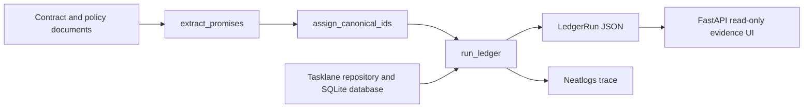

# Promise Ledger implementation guide

## 1. Mental model

Promise Ledger converts clauses from contracts and policies into structured `Promise` objects, assigns stable IDs such as `P-014`, compiles each promise into deterministic checks, executes those checks against Tasklane code/data/configuration, and produces a `LedgerRun`. The web UI does not run an audit; it renders a saved `LedgerRun` JSON file.

## 2. Architecture



## 3. Entry points

| Entry point | File and symbol | Purpose |
| --- | --- | --- |
| Full live audit | `ledger/cli.py` — `audit_command()` | Extract promises from documents, assign canonical IDs, run checks, and save evidence JSON. |
| Deterministic run | `ledger/cli.py` — `run_command()` | Run already extracted promises without another model extraction call. |
| Benchmark | `ledger/cli.py` — `bench_command()` | Compare naive v1 verdict semantics with grounded v2 semantics. |
| Evidence UI | `ledger/web.py` — `main()` and `create_app()` | Load a saved JSON artifact and render the ledger page. |

## 4. End-to-end audit flow

### Flow: document to evidence ledger

**Trigger:** `ledger audit` from the CLI.

**Entry point:** `ledger/cli.py` — `audit_command()`.

1. `ledger/documents.py` — `load_document()` loads PDF or Markdown content.
2. `ledger/agents/extractor.py` — `extract_promises()` sends each document through the configured JSON LLM backend and validates structured promises.
3. `ledger/registry.py` — `assign_canonical_ids()` maps extracted promises to stable IDs such as `P-014`.
4. `ledger/orchestrator.py` — `run_ledger()` opens the single Neatlogs `ledger_run` workflow root and delegates to `_run_ledger()`.
5. `ledger/inventory.py` — `build_inventory()` inventories the target. `ledger/entire_graph.py` — `search_entire_graph()` optionally augments that inventory with ranked Entire Graph hits.
6. `ledger/agents/compiler.py` — `compile_checks()` maps supported promise kinds to fixed probe templates.
7. `ledger/probes/runner.py` — `run_probe()` runs a primary probe and runs its declared fallback only when the primary outcome is `error`.
8. `ledger/probes/executors.py` — `execute_probe()` dispatches to SQLite, source-AST, Terraform, JSON, or simulated cloud checks.
9. `ledger/verdict.py` — `evaluate_verdict()` calculates `holds`, `violated`, or `unverifiable` from effective results.
10. `ledger/conflicts.py` — `detect_conflicts()` detects incompatible promises across documents.
11. `audit_command()` serializes the final `LedgerRun` to the requested evidence file.

**Final outcome:** a reproducible JSON artifact plus a flushed Neatlogs workflow trace.

## 5. Saved evidence to UI flow

**Trigger:** `PROMISE_LEDGER_RUN=<path> uv run ledger-ui`.

**Entry point:** `ledger/web.py` — `main()`.

`main()` reads `PROMISE_LEDGER_RUN`, creates the FastAPI app, and starts Uvicorn. On `GET /`, `ledger_page()` reads the JSON artifact, calculates the effective result for each probe, counts verdicts and conflicts, and renders `ledger/templates/ledger.html`. Styling lives in `ledger/static/ledger.css`.

The current demo uses:

| URL | Saved evidence | Meaning |
| --- | --- | --- |
| `http://127.0.0.1:8000` | `evidence/run_live_audit.json` | Original audit; `P-014` is violated. |
| `http://127.0.0.1:8001` | `evidence/run_remediated.json` | Isolated after-fix verification; `P-014` holds. |

## 6. Data flow

```text
Document text
  -> extracted Promise objects
  -> canonical Promise IDs
  -> compiled Probe objects
  -> primary/fallback ProbeResult objects
  -> PromiseReport verdicts
  -> LedgerRun JSON
  -> read-only HTML evidence cards
```

The durable state is the saved evidence JSON. Neatlogs stores observability traces. The UI has no database and performs no mutation.

## 7. Files and responsibilities

| File | Important symbol | Responsibility | Called by | Calls / depends on |
| --- | --- | --- | --- | --- |
| `ledger/cli.py` | `audit_command()` | Full audit orchestration and serialization | CLI | documents, extractor, registry, orchestrator |
| `ledger/orchestrator.py` | `run_ledger()` | Single traced workflow root | CLI | inventory, compiler, probes, verdicts, conflicts |
| `ledger/agents/compiler.py` | `compile_checks()` | Promise-to-probe mapping | orchestrator | models and asset inventory |
| `ledger/probes/runner.py` | `run_probe()` | Error capture and fallback execution | orchestrator | probe executor, trace ID capture |
| `ledger/probes/executors.py` | `execute_probe()` | Deterministic check execution | probe runner | SQLite, AST, Terraform, JSON |
| `ledger/verdict.py` | `evaluate_verdict()` | Final verdict semantics | orchestrator | effective probe outcomes |
| `ledger/conflicts.py` | `detect_conflicts()` | Cross-document conflict detection | orchestrator | promises |
| `ledger/web.py` | `create_app()` | Saved-artifact web view | `ledger-ui` | Jinja template and CSS |
| `ledger/templates/ledger.html` | ledger template | Audit cards and evidence chains | FastAPI/Jinja | rendered context |

## 8. State, side effects, and external systems

- The LLM backend is called only during document extraction.
- SQLite checks are read-only during an audit.
- Source, Terraform, and JSON probes read files under the target root; `_target_path()` prevents path escape.
- Evidence JSON is written by CLI commands.
- Neatlogs receives workflow/span telemetry when `NEATLOGS_API_KEY` is available.
- Entire Graph is invoked read-only with a ten-second timeout. Failure returns no graph hits and does not stop ordinary inventory.
- The web UI reads its configured evidence file on each page request and does not change it.

## 9. Error and fallback behavior

`run_probe()` catches executor exceptions and records them as `error`. It runs a fallback only when the primary result is `error` and the probe declares a fallback. `P-017` demonstrates this: a simulated cloud `AccessDenied` becomes an error, then the Terraform fallback passes, so the promise holds.

A promise with no grounded probes becomes `unverifiable`; it is not assumed to pass. Unsupported probe templates raise an error that is recorded by the runner. Entire Graph failure degrades to ordinary filesystem/configuration inventory.

## 10. Configuration

| Setting | Purpose |
| --- | --- |
| `PROMISE_LEDGER_RUN` | Saved evidence file displayed by the UI. Defaults to `evidence/run_live_audit.json`. |
| `PROMISE_LEDGER_HOST` | UI bind host. Defaults to `127.0.0.1`. |
| `PROMISE_LEDGER_PORT` | UI port. Defaults to `8000`. |
| `NEATLOGS_API_KEY` | Enables Neatlogs capture. |

LLM provider configuration is loaded by `ledger/llm.py` — `AzureJsonBackend.from_env()`. Secret values are intentionally not documented.

## 11. Implementation decisions

- Stable promise IDs allow the same obligation to be compared across extraction runs and remediations.
- Fixed probe templates constrain agent behavior and keep checks reproducible.
- `unverifiable` is a first-class verdict so missing evidence cannot become false confidence.
- Fallbacks are declared on probes and are used only for tool errors.
- The UI renders saved artifacts, separating demonstration and review from network-dependent execution.
- One explicit Neatlogs workflow root keeps all audit spans on the same trace.

## 12. How to modify the implementation

| If I want to change... | Start here | Then inspect... | Main risk |
| --- | --- | --- | --- |
| Promise extraction | `ledger/agents/extractor.py` | `ledger/llm.py`, `ledger/models.py` | Changing structured output or token use |
| Promise-to-check rules | `ledger/agents/compiler.py` | `ledger/inventory.py`, executor templates | Producing unsupported or ungrounded checks |
| A deterministic check | `ledger/probes/executors.py` | `ledger/probes/runner.py`, related tests | Unsafe paths, SQL identifiers, or wrong pass/fail semantics |
| Verdict rules | `ledger/verdict.py` | `ledger/benchmark.py` | Reintroducing false holds/violations |
| Fallback behavior | `ledger/probes/runner.py` | probe definitions and tracing tests | Hiding real failures or executing fallback too broadly |
| Evidence page | `ledger/templates/ledger.html` | `ledger/web.py`, `ledger/static/ledger.css` | Presenting primary errors instead of effective fallback results |

## 13. Key files to understand first

| Order | File / symbol | Why read this first |
| ---: | --- | --- |
| 1 | `ledger/cli.py` — `audit_command()` | Full user-facing entry point. |
| 2 | `ledger/orchestrator.py` — `run_ledger()` | Central execution path. |
| 3 | `ledger/agents/compiler.py` — `compile_checks()` | Converts contractual meaning into checks. |
| 4 | `ledger/probes/runner.py` and `executors.py` | Executes evidence checks and fallbacks. |
| 5 | `ledger/web.py` and `ledger/templates/ledger.html` | Explains what the demo UI displays. |

## 14. Quick reference

- Original saved audit: `evidence/run_live_audit.json`
- Remediated saved audit: `evidence/run_remediated.json`
- Benchmark: `evidence/benchmark.json`
- Human-readable final result: `evidence/run_final.md`
- Demo operator instructions: `docs/demo-recording-guide.md`
- Contract behind `P-014`: `contracts/Northwind_DPA_v3.pdf`, section 7.2
- Tasklane PRs: `khushalkumar/tasklane-demo` PRs 1 and 2

## 15. Complete execution walkthrough

For a full audit, `audit_command()` loads three documents and calls the LLM once per document. The registry turns equivalent extracted clauses into the nine canonical IDs. `run_ledger()` starts the workflow trace, builds a target inventory, asks the compiler for grounded probes, and executes each probe. `P-014` reads purge source code, queries terminated-tenant rows in SQLite, and checks Terraform retention. `P-017` records a cloud permission error and uses its Terraform fallback. The verdict engine builds nine reports, conflict detection adds `C-003`, and the run is serialized. The UI later reads that file and displays the source clause, effective evidence, and verdict without rerunning any audit logic.
